[简体中文](./README.md) · [Website](https://thinkcap.lei6393.com) · [GitHub](https://github.com/SuperMarioYL/thinkcap)

<picture>
  <source media="(max-width: 600px) and (prefers-color-scheme: dark)" srcset="./assets/presentation/hero-mobile-dark.svg">
  <source media="(max-width: 600px)" srcset="./assets/presentation/hero-mobile-light.svg">
  <source media="(prefers-color-scheme: dark)" srcset="./assets/presentation/hero-dark.svg">
  
</picture>

# thinkcap

**Inspect reasoning budgets before changing a live stream.**

thinkcap profiles visible think-block text by task class, stores observations and emits a budget policy for its advisory streaming proxy.

## Why use it

A rename and a refactor may produce different trace lengths. Separate their observations first, keep the count source visible, and use the policy to identify when a stream crosses the selected budget.

- **Separate task classes** — Each class keeps its own observed distribution.
- **Handle split delimiters** — The parser tracks incomplete markers across chunks.
- **Keep count provenance** — Profiles distinguish tokenize results from estimates.

## Architecture

<picture>
  <source media="(max-width: 600px) and (prefers-color-scheme: dark)" srcset="./assets/presentation/architecture-mobile-dark.svg">
  <source media="(max-width: 600px)" srcset="./assets/presentation/architecture-mobile-light.svg">
  <source media="(prefers-color-scheme: dark)" srcset="./assets/presentation/architecture-dark.svg">
  
</picture>

The profiler sends the five-task suite or uses canned responses, extracts marked think blocks and derives per-class p90 budgets. ThinkStreamParser tracks split delimiters and UTF-8 bytes. The FastAPI proxy classifies the request, forwards SSE and logs threshold decisions; it does not currently alter upstream generation.

| Component | Responsibility |
| --- | --- |
| `Task profiling` | thinkcap/profiler.py |
| `Policy + observations` | policy.py; budget_store.py |
| `Incremental parser` | trace_parser.py |
| `Advisory SSE proxy` | thinkcap/proxy.py |

## Install and quickstart

Use the runtime version declared in the repository manifest. The source installation below makes the included example reproducible.

```bash
git clone https://github.com/SuperMarioYL/thinkcap.git
cd thinkcap
python3.12 -m venv .venv
source .venv/bin/activate
python -m pip install -e .
```

Python 3.10+; Python 3.12 is used in these installation steps. Run mock profiling, then feed a complete synthetic split-delimiter stream to the real parser.

```bash
.venv/bin/python examples/presentation_demo.py
```

## Recorded demo

<picture>
  <source media="(max-width: 600px) and (prefers-color-scheme: dark)" srcset="./assets/presentation/process-mobile-dark.svg">
  <source media="(max-width: 600px)" srcset="./assets/presentation/process-mobile-light.svg">
  <source media="(prefers-color-scheme: dark)" srcset="./assets/presentation/process-dark.svg">
  
</picture>

Mock profiling emits five policy classes; a synthetic open think block crosses the budget and the closed block does not trigger.

```text
mock policy classes: bugfix, new_file, refactor, rename, default
inside think: True
estimated threshold reached: True
after closing block: False
completed think blocks: 1
```

The complete command and output are recorded in [docs/demo-results.json](./docs/demo-results.json). Inputs and reproduction code are included in the repository.


The existing recording is retained for context; the text example above documents the reproducible scenario.

## Usage

Run these commands from the repository root after installation. Replace paths for your own data.

```bash
thinkcap probe --mock --policy policy.json --budgets budgets.json
# With your compatible local server:
thinkcap probe --server http://localhost:8080 --suite coding-mini --policy policy.json
thinkcap serve --upstream http://localhost:8080 --port 8088 --policy policy.json --dry-run
```

## Configuration

Task classes are rename, bugfix, refactor, new_file and default. Probe uses --server (or THINKCAP_SERVER), --model, --suite, --policy, --budgets and --profile; serve uses --upstream (or THINKCAP_UPSTREAM), --port, --policy and --profile. The default class falls back to 2048 tokens. --profile selects the trace pack (model delimiter surface): qwen3.8 (default, `<|im_start|>think`/`<|im_end|>`), deepseek-r1 and glm-4.6-z1 (both `<think>`/`</think>`); observations recorded in one budgets.json keep separate distributions per pack. The proxy forces streaming and binds 0.0.0.0 without an authentication layer, so deploy only in a suitably controlled network. /health reports configuration, not upstream readiness.

## Integrations and responsibilities

<picture>
  <source media="(max-width: 600px) and (prefers-color-scheme: dark)" srcset="./assets/presentation/integrations-mobile-dark.svg">
  <source media="(max-width: 600px)" srcset="./assets/presentation/integrations-mobile-light.svg">
  <source media="(prefers-color-scheme: dark)" srcset="./assets/presentation/integrations-dark.svg">
  
</picture>

Choose the input and output route that matches your workflow. The local example below exercises the stated subset.

| Route | Implemented role |
| --- | --- |
| Marked content deltas | im_start think / im_end |
| llama.cpp HTTP | Probe and streaming upstream |
| policy.json | Per-class budget rows |
| budgets.json | Recorded observations |
| FastAPI health | Configured upstream and classes |

## Limits and next steps

- The current proxy does not inject tokens, suppress reasoning or stop upstream computation. --accept changes logging/state only and is not an enforcement mode.
- Live token decisions use bytes divided by four; offline fallback counts characters. These are estimates, and a five-task mock profile is not a calibrated model budget.
- The parser matches literal delimiters in content according to the --profile trace pack (qwen3.8: `<|im_start|>think`/`<|im_end|>`; deepseek-r1 and glm-4.6-z1: `<think>`/`</think>`). Other reasoning fields or templates need separate support. The demo tests no current Qwen deployment.

Actual upstream budget control and a pass-rate parity study are future work. The shipped path supports profiling and advisory observation.

## License and contributions

See [LICENSE](./LICENSE). When reporting an issue, include a minimal input, the command, and the observed output.
