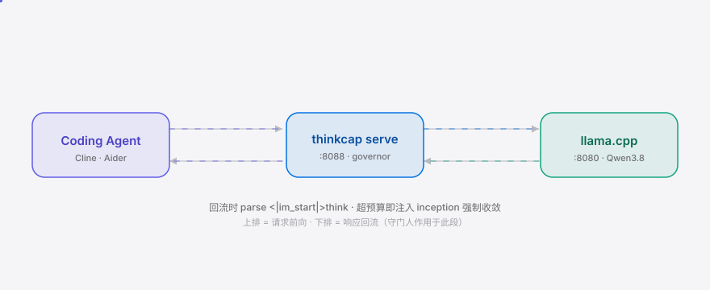

[English](./README.en.md) | **简体中文**

<div align="right"><sub><b>简体中文</b>&nbsp;&nbsp;⇄&nbsp;&nbsp;<a href="./README.en.md">EN</a></sub></div>

<picture>
  <source media="(prefers-color-scheme: dark)" srcset="./assets/hero-dark.svg">
  <source media="(prefers-color-scheme: light)" srcset="./assets/hero-light.svg">
  
</picture>

<p align="center"><sub>按任务自动调参 Qwen3.8 reasoning-budget 的守门人：按任务画像解析 think 轨迹、按预算注入 inception 强制收敛。</sub></p>

<p align="center">
  <a href="./LICENSE"></a>
  <a href="https://github.com/SuperMarioYL/thinkcap/releases"></a>
  <a href="https://github.com/SuperMarioYL/thinkcap/actions/workflows/ci.yml"></a>
  
  <a href="#share-this"></a>
  <a href="#share-this"></a>
</p>

**thinkcap 让 Qwen3.8 编码 agent 不再为欠规格任务空耗 reasoning token：按任务画像自动调参 llama.cpp `--reasoning-budget`，并在 think 轨迹超标时注入 inception 思考强制收敛，同一份 diff 用六分之一的 reasoning。**

<h2> 架构</h2>

<picture>
  <source media="(prefers-color-scheme: dark)" srcset="./assets/atlas-dark.svg">
  <source media="(prefers-color-scheme: light)" srcset="./assets/atlas-light.svg">
  
</picture>

## 目录

- [为什么需要](#为什么需要)
- [安装与快速开始](#安装与快速开始)
- [用法](#用法)
- [Demo](#demo)
- [配置](#配置)
- [路线图](#路线图)
- [License](#license)
- [分享](#share-this)

## 为什么需要

Qwen3.8-27B 通过 llama.cpp 跑在本地、挂在编码 agent 后面时，默认会过度思考：在一个一行 rename 上烧 ~3,000 reasoning token。今天唯一的杠杆是 llama.cpp 的静态 `--reasoning-budget`——一个你猜一次、放着不动的全局数字，它既不知道当前是哪个任务，也看不见模型此刻正在 think 轨迹里空转。thinkcap 的新动词是 **按任务画像解析 think 轨迹 → 中途注入 inception 治理**：测量每个任务类实际烧了多少 reasoning token，学一个预算，当实时轨迹超标时注入 ggerganov 的 inception 模式强制模型动手。

为什么是现在：过去半年三件事同时就位——(1) Qwen3.8-27B 带着 per-model 的过度思考默认值上线，Simon Willison 本月刚公开点名；(2) ggerganov 在 llama.cpp 上了 `--reasoning-budget` + inception 模式，中途截断的机制从无到有；(3) Qwen3.6→3.8 的 Jacobian lens 跨版本存活，证明 `<|im_start|>think` 轨迹结构稳定可建。这条产品就骑在这三件事的交汇点上。Claude/GPT 的 reasoning 轨迹不会以可被本地代理中途截断的方式回流给一个本地代理，所以这个按模型治理的原语对它们结构上不成立——这正是 Qwen3.8 独有的楔子。

## 安装与快速开始

```bash
pipx install thinkcap                      # 或 pip install -e .
thinkcap probe --server http://localhost:8080 --suite coding-mini
thinkcap serve --policy policy.json --dry-run
```

前置：你已在 `:8080` 跑着本地 llama.cpp + Qwen3.8-27B GGUF（`--reasoning-budget 0`，不设上限）。`probe` 跑 5 个固定任务、解析每条流式响应里的 `<|im_start|>think` 块、经 `/tokenize` 端点数 reasoning token（端点不可用时退化为字符估算并在表里标 `approx`），输出一张按任务类的 rich 表 + `policy.json`。`serve` 起一个 OpenAI 兼容的流式反代在 `:8088`，把编码 agent 的 `base_url` 指过去即可。

<details><summary>无服务器也能跑（CI / 演示模式）</summary>

```bash
thinkcap probe --mock --policy ./policy.json --budgets ./budgets.json
```
`--mock` 用内置的 canned 响应跑完整流水线，不需要活的 llama.cpp——README 的 demo gif 就是用它渲染的。真实的前后对比（3,100 → ~620 token）需要对着你自己的服务器跑。
</details>

## 用法

<h3> 五个常用工作流</h3>

```bash
# 1. 建基线：对着你的 llama.cpp 跑 coding-mini，得到 policy.json
thinkcap probe --server http://localhost:8080 --policy ./policy.json

# 2. 干跑守门人（v0.1 默认 = advisory）：日志记 "would inject at N tokens" 但不改流
thinkcap serve --policy ./policy.json --dry-run --port 8088

# 3. 把编码 agent 指过去（Cline / Aider / continue.dev 都兼容 OpenAI API）
#    base_url = http://127.0.0.1:8088/v1

# 4. 回看观察日志（按任务类的原始 token 分布）
cat budgets.json

# 5. 看健康/状态（确认上游、生效类、是否 enforce）
curl -s http://127.0.0.1:8088/health
```

三个子命令：`probe`（测量 + 写策略）、`serve`（OpenAI 兼容反代，v0.1 为 advisory / 干跑）、`suites`（列出可用任务套件）。完整字段见 `thinkcap probe --help`。

## Demo


asciinema 录制见 `demos/thinkcap-demo.cast`（`thinkcap probe --mock` → rich 表 → `policy.json` → `thinkcap serve --dry-run` + `/health`）。vhs tape 在 `docs/demo.tape`，`.github/workflows/demo.yml` 在打 tag 时重渲染 gif。

v0.1 的 demo 用 `--mock`（canned 响应，无需服务器），所以 token 数字是缩放的机制演示，不是真实 Qwen3.8 输出。真实的前后对比（一个一行 rename 上 3,100 → ~620 reasoning token、同一份 diff）需要对着你自己的 llama.cpp + Qwen3.8 跑 `thinkcap probe`（无 `--mock`），再 `thinkcap serve --accept`——`--accept` 在 m3 的 pass-rate 奇偶校验通过前不会默认开启，宁可少发也不发一个会搞坏编码 agent 的守门人。

## 配置

| 键 | 类型 | 默认 | 含义 |
|---|---|---|---|
| `--server` | URL | `http://localhost:8080` | 你的 llama.cpp 服务器（`probe` 用） |
| `--suite` | str | `coding-mini` | 任务套件（5 任务，覆盖 rename/bugfix/refactor/new_file/default） |
| `--policy` | path | `policy.json` | `probe` 写出 / `serve` 读入的 per-class 预算 |
| `--budgets` | path | `budgets.json` | 原始观察追加日志（重跑同类会扩宽分布） |
| `--port` | int | `8088` | `serve` 监听端口 |
| `--upstream` | URL | `http://localhost:8080` | `serve` 转发的上游 llama.cpp |
| `--dry-run/--accept` | bool | `--dry-run` | advisory（记 would-inject）vs enforcing（m3 奇偶校验通过后注入） |

`policy.json` 形状：

```json
{
  "version": "0.1.0",
  "budgets": [
    { "task_class": "rename",   "budget_tokens": 620,  "source": "p90_observed", "inception_token": " ...Acting now.\n<|im_end|>" },
    { "task_class": "default",  "budget_tokens": 2048,  "source": "manual",        "inception_token": " ...Acting now.\n<|im_end|>" }
  ]
}
```

## 路线图

- [x] **m1 — profile reasoning trace**：`thinkcap probe` 跑 5 任务、解析 `<|im_start|>think`、`/tokenize` 计数（带 `approx` 兜底）、出 rich 表 + `policy.json`。
- [ ] **m2 — proxy inception**：`thinkcap serve` 真正在流中途注入 inception token，超预算时把 think 块剩余部分作为 suppressed 冲掉；默认 `--dry-run`。
- [ ] **m3 — probe & govern loop**：闭环——`probe` 学 per-class p90，`serve` 强制执行；10 任务套件证明在更低 reasoning-token 总量下 pass-rate 持平；`--accept` 把 advisory 翻成 enforcing。
- [ ] **v0.2** — DeepSeek-R1 / GLM-4.6-Z1 trace pack（不同分隔符，同一原语）。
- [ ] **v0.3+** — 与 Cline/Aider 的 "reasoning policy" 钩子集成；按月发布 "reasoning-token burn report"。

## License

[MIT](./LICENSE)。提 issue / PR 直接在 [SuperMarioYL/thinkcap](https://github.com/SuperMarioYL/thinkcap) 开即可。

## Share this

```
thinkcap — 按 Qwen3.8 coding agent 任务画像自动调 reasoning-budget 的守门人，中途注入 inception，同一个 diff 用六分之一的 reasoning。https://github.com/SuperMarioYL/thinkcap
```

<p align="center"><sub><a href="./LICENSE">MIT</a> © 2026 SuperMarioYL</sub></p>
